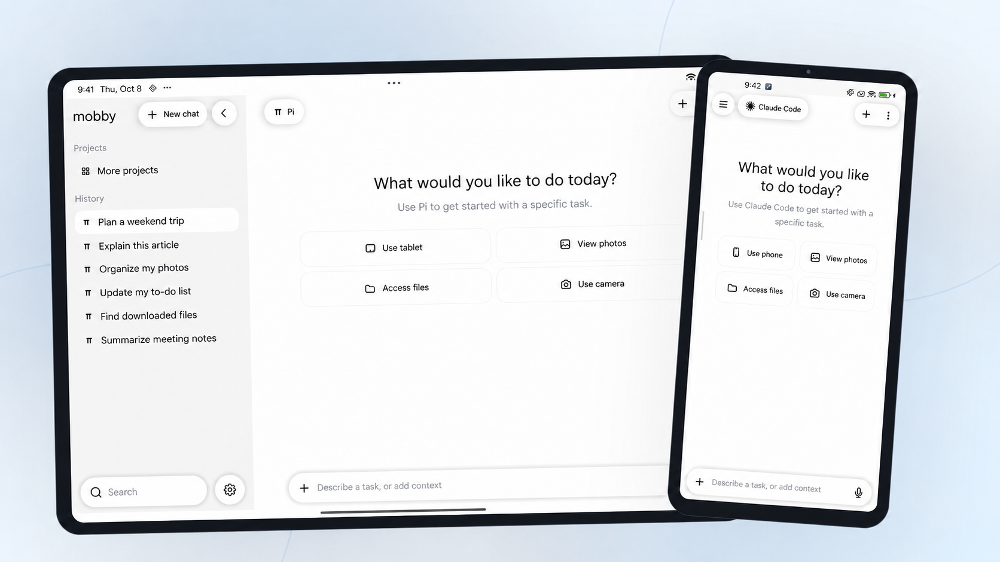
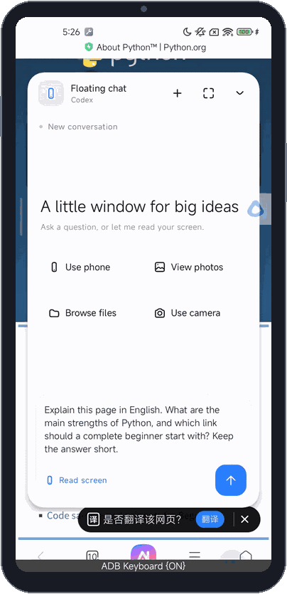
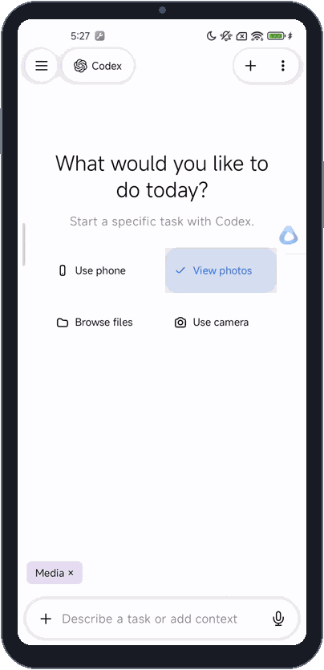
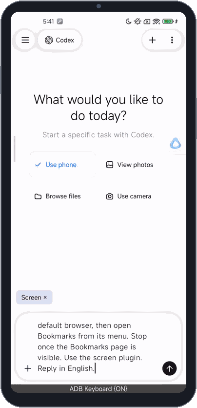
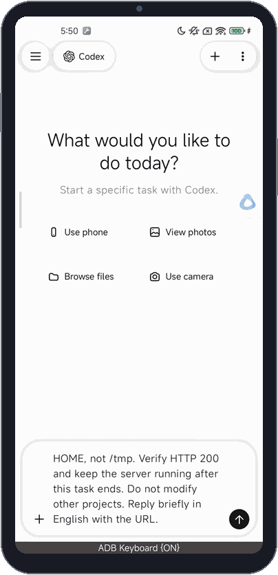

  

<h1 align="center">mobby</h1>

<b>Your personal AI agent, running on Android.</b> Ask about your screen, work with files, use apps, and write code — right on your phone or tablet.

  
  
  
  

<b>English</b> · <a href="docs/README.zh-CN.md">简体中文</a>

  Runs <b>Pi</b> · <b>Claude Code</b> · <b>Codex</b> · <b>OpenCode</b> on-device, with access to your screen, photos, and files.

  <a href="#ask-about-whats-on-your-screen">Screen Q&amp;A</a> ·
  <a href="#work-with-photos-and-files">Photos and files</a> ·
  <a href="#let-it-use-apps-for-you">App control</a> ·
  <a href="#build-something-useful-on-your-device">Coding on Android</a> ·
  <a href="#getting-started">Getting started</a>

## What it can do

<table>
<tr>
<td width="55%" valign="middle">

### Ask about what's on your screen

Reading a page you don't understand? Tap the floating button, open the floating chat, and use screen recognition. Ask mobby to translate the text, explain it, or answer a follow-up question.

> 💬 *What is this page about? What makes Python useful, and where should a beginner start?*

</td>
<td width="45%" align="center">

</td>
</tr>
<tr>
<td width="45%" align="center">

</td>
<td width="55%" valign="middle">

### Work with photos and files

Add photo or file access to a task and choose the photos or folder to share. Ask mobby to describe an image, copy files, make a list, and save the results back to your phone.

> 💬 *Look at my recent photos, copy the latest one to the folder I selected, and create an image summary and a file list.*

</td>
</tr>
<tr>
<td width="55%" valign="middle">

### Let it use apps for you

Add phone or tablet access to a task and describe what you want to do. mobby reads the screen, taps buttons, types text, and moves between pages to carry out the steps.

> 💬 *Install Via browser from the app store and open Bookmarks.*

</td>
<td width="45%" align="center">

</td>
</tr>
<tr>
<td width="45%" align="center">

</td>
<td width="55%" valign="middle">

### Build something useful on your device

Describe what you need. The agent writes the code in your device's workspace, starts a local server, and opens the result in your browser.

> 💬 *Make a travel packing list with categories for documents, clothes, electronics, and toiletries. Let me check off, add, and delete items, and keep my changes after a refresh.*

[Browse the example code →](docs/examples/travel-checklist-en/)

</td>
</tr>
</table>

## Getting started

mobby supports ARM64 Android phones and tablets running Android 8.0 or later.

1. **Install mobby.** Get the APK from [Releases](https://github.com/ytlog/mobby/releases) and open it on your device. Wait for the runtime to initialize; Claude Code downloads from its official source during setup.
2. **Set up a gateway.** Open **Settings → Gateway settings**, choose a service or enter its base URL and API key, tap **Get models**, select a default model, then save the gateway.
3. **Start a conversation.** Select the gateway and send a task. For screen Q&A, enable the floating button, display-over-other-apps permission, and the Screen accessibility service. Grant photo or file access when you use those features.

## Learn more

  📖 <a href="docs/getting-started.md">Build and usage guide</a> ·
  🔌 <a href="docs/gateway.md">Gateway setup</a> ·
  🗂️ <a href="docs/README.md">Project docs</a> ·
  ⚖️ <a href="LICENSE">MIT license</a>

