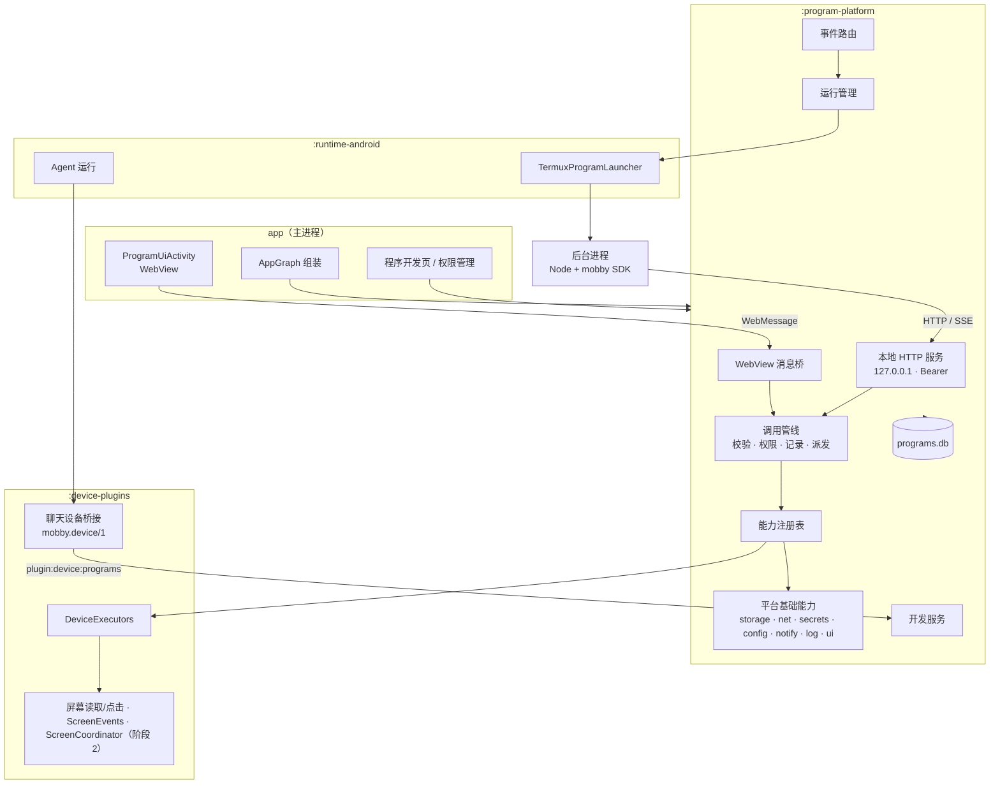
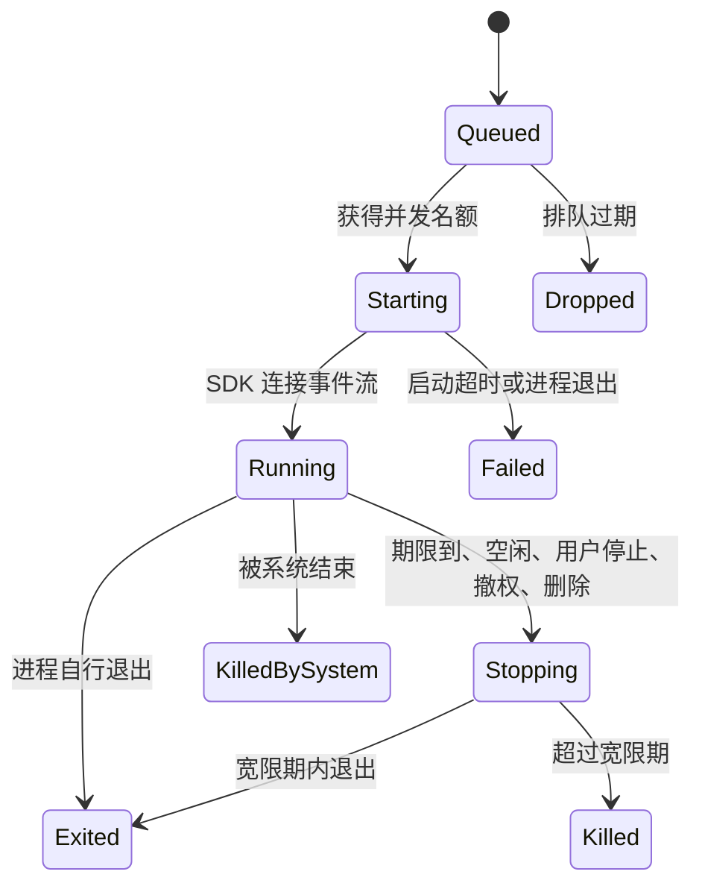
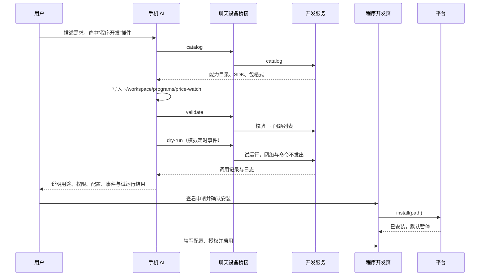
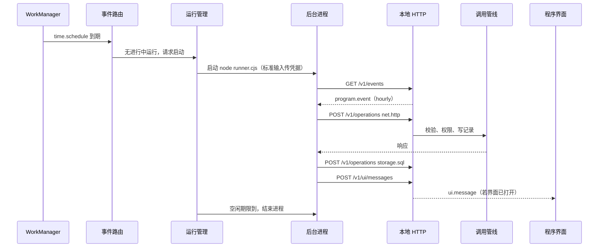

# 用户程序平台技术架构

状态：技术设计，尚未实现。日期：2026-10-24。

本文是 [Android 能力底座与用户程序平台设计](android-capability-platform.md) 的技术实现方案。产品范围、权限规则和阶段划分以方案文档为准；两者冲突时先修订方案文档，再修订本文。

## 1. 设计约束

- 遵守 [AGENTS.md](../../AGENTS.md)：不获取 root，不修改系统权限；网关密钥只在加密存储；开发数据库结构变化直接重建；现有聊天执行路径与 `mobby.device/1` 协议不变。
- 手机能力只有一套执行实现：程序路径复用 `device-plugins` 的执行器。
- 后台 Node 进程与 mobby 共享应用 UID，平台权限只约束经过 SDK 的调用；界面运行在 WebView 隔离渲染进程，平台权限对界面强制生效。
- 后台使用的本地 HTTP 服务沿用本地模型服务的做法：ktor CIO（项目已用 `ktor-server-cio` 2.3.12）、只绑定 `127.0.0.1`、Bearer 令牌。
- 新模块进入 `runtime/test_module_boundaries.py` 的依赖白名单，依赖方向由测试强制。
- 新增第三方依赖只有 `androidx.webkit`，版本选择已发布两周以上的稳定版。

## 2. 总览



三条主路径：

1. 能力调用：后台经本地 HTTP、界面经 WebView 消息桥，进入同一条调用管线：认证调用方 → 校验参数 → 权限闸门 → 写操作记录 → 派发处理器 → 回执。
2. 事件：事件来源 → 事件路由（订阅匹配、权限投影）→ 交给进行中的运行，或请求运行管理拉起后台进程。
3. 开发：对话中的 Agent 经现有聊天设备桥接调用开发服务；安装、授权、配置只在程序开发页进行。

## 3. 模块

### 3.1 Gradle 模块与依赖

| 模块 | 目录 | 职责 | 项目依赖 |
| --- | --- | --- | --- |
| `:program-platform`（新增） | `runtime/programs` | 注册表、调用管线、权限、程序存储与安装、运行管理、事件路由、平台基础能力、WebView 宿主逻辑、本地 HTTP、开发服务 | `device-plugins`、`runtime-api`、`localization` |
| `:device-plugins`（扩展） | `runtime/device-plugins` | 公开执行入口、开发插件目录项与端口；阶段 2 的屏幕读取与点击、屏幕事件、屏幕协调器 | 不变：`runtime-api`、`localization` |
| `:runtime-android`（扩展） | `runtime/android` | 后台进程启动器、SDK 安装；阶段 2 的模型网关端口 | 增加 `program-platform` |
| `app`（扩展） | `app` | 组装；程序开发页、权限管理、`ProgramUiActivity` | 增加 `program-platform` |

依赖方向：`app → runtime-android → program-platform → device-plugins → runtime-api`。`device-plugins` 不依赖 `program-platform`；开发插件通过端口由 `app` 注入实现。

源码包：`program-platform` 为 `com.github.ytlog.mobby.android.programs`；`app` 中的界面为 `com.github.ytlog.mobby.android.programcenter`。界面包可以复用 `conversation.ui` 的设置组件；`conversation.ui` 不引用程序平台，程序开发页经 `ConversationHostActions` 注入的页面插槽进入导航，入口是输入框“+”菜单中的“程序开发”，返回时回到该菜单；从左侧栏进入时返回对话。左侧栏的程序快捷入口由宿主以 `ProgramShortcut` 列表注入，`conversation.ui` 只负责展示和导航。

### 3.2 `:program-platform` 内部包

| 包 | 内容 |
| --- | --- |
| 根包 | `ProgramPlatform` 门面：供 `app` 与 `runtime-android` 调用的安装、启停、授权、配置、记录查询与状态 `Flow` |
| `capability` | `CapabilityDescriptor`、`CapabilityRegistry`、`CapabilityHandler`、现有设备动作的适配器 |
| `call` | `CallPipeline`、`CallContext`、操作记录与去重 |
| `permission` | 权限模型、`PermissionResolver`、`PermissionGate`、到期计时 |
| `program` | `mobby.program/1` 清单、`ProgramPackageReader`、安装、版本、删除 |
| `run` | `RunSupervisor`、运行状态机、运行凭据、`ProgramProcessLauncher` 端口 |
| `event` | 事件信封、`EventSource`、`EventRouter`、订阅索引、定时来源 |
| `base.storage` | 键值、私有文件、每程序 SQLite、配额 |
| `base.net` | 受管 HTTP、域名与地址检查、流量记录；阶段 2 的 WebSocket |
| `base.secrets` | 凭据加密存储与请求时替换 |
| `base.config` | 配置字段、值与校验 |
| `base.notify` | 程序通知与“打开界面”动作 |
| `ui` | `ProgramUiHost`：WebView 加载器、请求拦截、内容安全策略、消息桥、界面会话 |
| `api` | ktor 服务、路由、SSE |
| `dev` | 能力目录生成、校验、试运行、记录读取 |
| `store` | Room 数据库 `programs.db`、DAO、保留与清理 |

### 3.3 `:device-plugins` 的扩展

| 新增 | 阶段 | 说明 |
| --- | --- | --- |
| `DeviceExecutors` | 1 | 公开入口，包装内部的 `DeviceActions`，接受与传输无关的执行上下文（取消检查、临时目录、资源登记）。聊天路径继续经 `DeviceCommands` 调用同一执行器 |
| 目录项 `programs` | 1 | `DeviceCatalog` 新增“程序开发”插件，命令 `catalog`、`validate`、`dry-run`、`records` |
| `ProgramDevelopmentPort` | 1 | 开发命令的端口，由 `app` 启动时注入；未注入时插件显示为不可用 |
| `ScreenWindow`、`ScreenNode` | 2 | 当前窗口的不可变快照；密码字段显示为 `[secure]` |
| `ScreenAccessService.withWindow` | 2 | 在调用线程读取一次窗口，并在节点释放前按索引点击；不截图、不隐藏悬浮窗、不固定等待 |
| `ScreenEvents` | 2 | 无障碍事件元数据转发；按需求方登记，通过 `setServiceInfo` 动态增加内容变化事件 |
| `ScreenCoordinator` | 2 | 聊天屏幕会话优先；后台派发租约；聊天动作等待进行中的后台派发 |

现有 `snapshot`、`click(query)`、`tap` 等聊天动作的语义不变。

### 3.4 `:runtime-android` 的扩展

- `TermuxProgramLauncher` 实现 `ProgramProcessLauncher`：以 `RuntimeEnvironment.termuxConfig` 取得与 Agent 运行相同的 termux 单例，用现有执行器启动 `node runner.cjs`，独立进程组；登记 PID 与启动时间，沿用 `ProcessRegistry` 的身份校验防止 PID 复用误杀。程序进程与 Agent 进程分开登记。运行环境尚未安装或 Node 不可用时启动失败，原因为 `runtime_not_installed` 或 `runtime_not_ready`。
- 程序的标准输出和标准错误写入每次运行的日志文件，单个上限 256 KB。
- SDK（`mobby` 模块与 `runner.cjs`）随 `program-platform` 的 assets 打包，平台启动时写入程序目录下的 `sdk/`，随应用版本更新；后台进程通过 `NODE_PATH` 引用。
- 阶段 2：实现 `ModelGatewayPort`，供 `ai.call` 使用现有网关配置与本地 Node 桥接。

### 3.5 `app` 的扩展

- `AppGraph` 创建 `ProgramPlatform`，注入 `TermuxProgramLauncher` 与开发端口，应用启动时启动平台。
- `programcenter` 包：程序列表（“待处理”为工作区中与已安装版本校验和不同或无法通过校验、且未被忽略的程序，“已安装”为程序及其用文字描述的状态和启停开关）、一步安装确认、程序详情（概览、权限、配置、事件、运行记录）、权限总览（按能力、按程序、按事件来源）。平台以 `pendingInstalls()` 列出待处理程序，以 `install(directory, InstallChoice)` 在同一次变更中安装、授权、保存配置并启用；`InstallChoice.checksum` 不符时抛出 `PackageChanged`，不做任何改动。用户在安装页“忽略这个版本”或删除程序时，平台把该工作区目录名与内容指纹（有效程序包时即校验和）记入 `dismissed_candidate`；目录内容不变时不再列出，AI 修改后重新出现；安装该目录会清除记录。工作区源文件从不被删除。
- `ProgramUiActivity`：承载 WebView 与固定标题栏，具体的加载、拦截与消息桥由 `ProgramUiHost` 提供。

## 4. 进程与线程

| 执行体 | 位置 | 说明 |
| --- | --- | --- |
| 平台控制 | 主进程，单线程协程调度器 | 安装、授权、配置、订阅变化、运行状态变化串行执行 |
| 事件路由 | 主进程，单线程 | 匹配订阅与分发，不做 I/O |
| 调用执行 | IO 调度器 | 存储、网络、设备执行器调用；复用的旧屏幕动作仍按原实现切到主线程 |
| 本地 HTTP | ktor CIO 线程 | 只绑定回环地址 |
| 程序界面 | 主线程 WebView；页面脚本在系统 WebView 的隔离渲染进程 | 消息桥收到请求后转到 IO 调度器执行，结果回主线程发给页面 |
| 后台进程 | Node 子进程 | 每个运行一个进程，由运行管理拉起、监视和结束 |
| 无障碍回调（阶段 2） | 主线程 | 只提取元数据交给事件路由 |

- 不新增 Android 进程；`:local_model` 进程与本平台无关。
- 第一阶段的后台运行是有期限的短任务，不新增前台服务。定时由 WorkManager 唤起主进程。后台时能否稳定拉起子进程是第一阶段必须实测的问题，见 [待验证问题](#20-待验证问题)。

## 5. 能力与调用管线

### 5.1 能力注册表

```kotlin
data class CapabilityDescriptor(
    val id: String,                 // "storage.sql"
    val version: Int,
    val kind: CapabilityKind,       // QUERY, COMMAND, EVENT, SESSION, HANDOFF
    val inputSchema: JsonObject,
    val outputSchema: JsonObject,
    val scope: ScopeKind,           // NONE, PACKAGES, DOMAINS, MODELS, RECORDS, DIRECTORIES
    val sideEffects: Set<SideEffect>,
    val prerequisites: List<Prerequisite>,
    val surfaces: Set<Surface>,     // BACKGROUND, UI；交接类能力只允许 UI
    val timeoutMillis: Long,
    val cancellable: Boolean,
    val limits: CapabilityLimits,
)

interface CapabilityHandler {
    val descriptor: CapabilityDescriptor
    fun availability(system: SystemState): Availability
    suspend fun invoke(call: CapabilityCall): CapabilityOutcome
}
```

- 注册表在启动时由代码登记，只包含有处理器的能力；能力目录、SDK 类型声明和开发技能都由注册表生成。
- 手机能力适配器把调用转换为 `DeviceExecutors.perform(plugin, action, args, context)`，`DeviceResult` 的 `effectState` 原样映射为调用的效果状态。

### 5.2 调用上下文

```kotlin
data class CallContext(
    val programId: String,
    val version: String,
    val surface: Surface,            // BACKGROUND 或 UI
    val runId: String?,              // 后台运行
    val uiSessionId: String?,        // 界面会话
    val dryRun: DryRunScope?,        // 试运行时的限制
)
```

- 后台：上下文由运行凭据确定。
- 界面：上下文由消息桥按页面来源与界面会话确定。
- 请求体中的任何身份字段都被忽略。

### 5.3 调用管线

1. 解析请求：`schema`、`requestId`、能力 ID、参数、期限；未知字段拒绝。
2. 去重：同一调用方同一 `requestId` 且参数指纹相同时返回原操作的状态与效果（正在执行时为 `accepted`），不重放结果；参数不同返回 `REQUEST_CONFLICT`。
3. 参数校验：按能力的 `inputSchema` 校验，并检查调用面（交接类能力只允许界面）。
4. 权限闸门：见第 6 节，得到授权修订号。
5. 写操作记录：状态为“已受理”，在派发前持久化。
6. 派发：调用处理器；派发前再次比较授权修订号，变化则重新检查。
7. 回执：更新操作记录的状态、效果与审计字段，结果只返回调用方一次，不写入记录。

试运行时，权限闸门以程序包清单申请的权限代替用户授权（系统权限与全局开关照常检查），第 6 步只派发两类调用：作用于程序自身空间的能力（存储），改用试运行专用的临时目录；聊天已允许的手机查询能力（试运行范围以能力 ID 列出）。其余调用不派发，记录后返回 `simulated`。

## 6. 权限

```kotlin
class PermissionGate(grants: GrantStore, switches: SwitchStore, system: SystemState, clock: Clock) {
    fun check(context: CallContext, capability: CapabilityDescriptor, scope: CallScope): GateDecision
}

sealed interface GateDecision {
    data class Allowed(val grantRevision: Long) : GateDecision
    data class Denied(val layer: Layer, val reason: DenyReason) : GateDecision
}
```

- 检查顺序：系统权限 → 全局开关 → 程序权限（开启、范围、到期）→ 调用上下文（调用面、试运行范围）。返回第一个不满足的层与原因。
- 范围匹配按能力的 `ScopeKind`：应用包名精确匹配；域名为精确主机名或 `*.` 后缀；模型为精确 ID。
- 订阅的有效性另由事件路由按订阅暂停状态与对应权限判断。
- 撤权、关闭全局开关或到期时，平台控制线程先更新授权并增加修订号，再取消该程序未派发的调用；关闭的是必需权限时向运行发送 `run.stopping`。
- 程序可用性由用户状态、必需权限、必填配置和事件来源计算，取值见方案文档 3.5 节。

## 7. 程序包与安装

- `ProgramPackageReader` 校验目录：只接受普通文件与子目录，拒绝符号链接、绝对路径和 `..`；限制文件数、单文件与总大小；清单严格解码，未知字段拒绝。
- 清单检查：`background` 与 `ui.entry` 至少一个且文件存在；权限只能引用注册表中的能力，范围符合其 `ScopeKind`；配置字段类型合法，`secret` 字段的域名在 `net.http` 申请范围内；订阅只能引用事件能力，过滤范围不超出对应权限申请。
- 界面检查：HTML 中不含内联脚本和内联事件处理属性；不引用外部地址的脚本、样式、图片和框架页面。
- 安装把文件复制到 `files/programs/packages/<id>/<version>-<checksum>/`，先写临时目录再原子重命名；数据库记录版本、校验和与清单。后台进程和界面都从安装副本运行。
- 更新时，旧版本的运行按旧版本结束；新版本的权限只继承旧授权与新申请的交集，扩大的部分等待用户授予；配置按字段键保留，类型变化的字段清空并要求重新填写。

## 8. 运行管理

```kotlin
interface ProgramProcessLauncher {
    fun launch(spec: ProcessSpec): ProgramProcess
}

data class ProcessSpec(
    val runId: String, val packageDir: File, val entry: String,
    val workDir: File, val sdkDir: File, val apiPort: Int, val credential: String,
)

interface ProgramProcess {
    val pid: Int
    suspend fun awaitExit(): Int?             // 退出码，被信号结束时为 128 + 信号号
    fun terminate()                           // SIGTERM 进程组，随后 SIGKILL
}
```



- 每个运行是一个独立的 Node 进程；多个程序可以同时运行。同一程序同一时间最多一个运行，期间的事件送入该运行的队列。
- 不在一个共享 Node 进程里用 `worker_threads` 或 `vm` 运行多个程序：一个程序的崩溃、死循环或内存耗尽会影响其他程序，也无法单独结束。
- 全局并发、运行期限、空闲退出时间、排队长度和过期时间有上限，实测后写入配置。并发上限低于 Android 12 起的子进程限制。
- 运行先登记运行记录、凭据和事件队列，再启动进程；启动失败时撤销登记。子进程在启动器返回前就可能调用接口。
- 每次运行生成随机凭据，绑定 programId、版本、runId 与试运行范围；凭据只在内存中，运行结束作废，经子进程标准输入的第一行传入，不放在参数、环境变量或文件里。
- 页面控制台报告的错误由 `ProgramUiHost` 写入程序日志（`page_error`，每个页面最多 20 条）；`validate` 经 `ProgramProcessLauncher.checkSyntax` 用 SDK 的 `check.cjs` 解析全部脚本而不执行，运行环境不可用时如实给出警告。
- 运行器的退出码：0 表示本次收到的事件都已处理；任一处理函数抛错或未注册时，运行器记录 `handler_failed`/`handler_missing` 日志并继续处理后续事件，结束时以 1 退出；运行器自身失败（无法启动、事件流中断）以 2 退出。界面上的程序状态按此显示“正常”或“失败”。
- 原生层把被信号结束的进程报告为 `128 + 信号号`，与进程自己以同样数值退出无法区分。退出码为 137（SIGKILL）且不是平台发起的结束时，运行记为“被系统结束”；其余大于 128 的退出只记录信号号。
- 运行中的事件队列有上限，超出的事件丢弃并计入运行记录的 `droppedEvents`；队列为 `run.stopping` 预留一个位置，停止通知总能送达。
- 运行结束时：未派发的调用标记为取消；已派发的等待执行器回执，拿不到可靠结果的记为 `unknown`。
- 应用进程重启时：按 PID 与启动时间结束遗留的后台进程；未结束的运行记为中断；已派发未回执的调用记为 `unknown`，不重发。

## 9. 程序界面

### 9.1 宿主

- `ProgramUiActivity` 全屏显示 WebView，顶部固定 mobby 的标题栏（程序名称、返回、停止），程序不能隐藏。
- 打开入口：程序开发页，以及 `notify.show` 带“打开界面”动作的通知。阶段 2 增加分享与快捷方式。
- 每次打开生成界面会话 `uiSessionId`，关闭页面即结束。界面会话不延长后台运行。
- 运行时检查 `WebViewFeature.WEB_MESSAGE_LISTENER`；不支持时不打开界面并提示更新系统 WebView。

### 9.2 加载

- 每个程序使用独立页面源 `https://<programId>.program.invalid/`；`.invalid` 是保留顶级域，不会解析到真实网站。
- `WebViewAssetLoader` 把该源映射到安装副本的 `ui/` 目录；`/_mobby/sdk.js` 由平台提供。
- WebView 设置：关闭 `allowFileAccess`、`allowContentAccess`、地理位置和多窗口；关闭 DOM Storage，程序数据统一走 `storage.*`；禁止混合内容；保持安全浏览开启。

### 9.3 拦截与内容安全策略

- `shouldInterceptRequest`：本程序源的请求由加载器返回，其他请求一律返回 403；Service Worker 请求同样处理。
- 平台返回的 HTML 附带内容安全策略：`default-src 'self'; script-src 'self'; style-src 'self' 'unsafe-inline'; img-src 'self' data: blob:; connect-src 'self'; frame-src 'none'; object-src 'none'; base-uri 'none'; form-action 'none'`。外部 `fetch`、WebSocket 和内联脚本因此被拒绝。
- `shouldOverrideUrlLoading`：本程序源内导航允许；其他链接不在 WebView 中打开，经用户确认后交给系统浏览器。
- `WebChromeClient`：`onPermissionRequest` 一律拒绝，`onCreateWindow` 拒绝；文件选择、拍照经平台交接能力完成，需要用户在页面上主动操作。
- `onRenderProcessGone`：销毁该 WebView，显示错误并允许重新打开。

### 9.4 消息桥

- `WebViewCompat.addWebMessageListener` 注册名为 `mobbyBridge` 的监听，允许的来源只有本程序源；不使用 `addJavascriptInterface`。
- 页面请求进入调用管线，上下文为该程序的界面会话；结果和推送经 `replyProxy.postMessage` 返回。消息大小与每秒调用次数有上限。

### 9.5 界面与后台

- 页面 `mobby.ui.send(message)`：平台向后台投递 `ui.message` 事件（处理函数收到 `{ message }`），没有进行中的运行时按需拉起；程序没有后台逻辑时返回 `UNSUPPORTED`。
- 后台 `mobby.ui.post(message)`：平台转发给该程序已打开的界面会话，返回送达的会话数；没有打开的界面时返回 0，不排队。
- 后台与页面 SDK 在发出请求前检查参数类型（路径与 SQL 为字符串、`params` 与 `statements` 为数组、选项为对象），不符时以 `TypeError` 拒绝，信息给出正确的调用形式，例如 `files.write(path, text): path must be a string, got an object. Arguments are positional, …`。
- 平台把浅色或深色模式、字体缩放和安全区域边距以 CSS 媒体查询与变量提供给页面。

## 10. 事件

```kotlin
interface EventSource {
    val type: String                      // "time.schedule"
    fun demand(scopes: Set<Scope>)       // 由路由按有效订阅的并集设置
}

data class ProgramEvent(
    val eventId: String, val type: String, val source: String,
    val observedAt: Long, val expiresAt: Long?, val scope: Scope, val payload: JsonObject,
)
```

- 订阅索引按事件类型和范围建立；权限、订阅、启用状态、配置变化时在平台控制线程重建，再整体替换给路由。
- 每个事件先过滤，再做权限投影；只有当前有效的订阅收到事件。
- 分发：该程序已有运行时放入其事件队列（有界；可合并的事件只保留最新）；否则请求运行管理拉起。
- 定时来源（阶段 1）：`time.schedule` 订阅登记为 WorkManager 任务，周期最短 15 分钟；需要精确时间且满足条件时用 AlarmManager。到期唤起主进程后由路由分发；错过策略按订阅配置。重启后重新登记。
- 平台事件（阶段 1）：`ui.message`、`config.changed`、`permission.changed`、`subscription.changed`、`run.stopping` 由平台直接投递。
- 屏幕来源（阶段 2）：`ScreenEvents` 在有 `screen.window` 订阅时增加内容变化事件类型；事件只含包名、类名、时间，程序需要节点时调用 `screen.read`。

## 11. 平台基础能力的实现

### 11.1 存储

| 能力 | 实现 |
| --- | --- |
| `storage.kv` | `programs.db` 的 `program_kv` 表；键长、值大小和总量有上限 |
| `storage.files` | `files/programs/data/<programId>/files/` 下的相对路径；规范化后必须仍在该目录内，拒绝符号链接；大文件流式读写 |
| `storage.sql` | 每个程序一个 SQLite 文件 `files/programs/data/<programId>/sql/main.db`，用 Android `SQLiteDatabase` 打开 |

`storage.sql`：

- 接口为 `query`、`execute` 和 `transaction`；参数按位置绑定；结果行数与大小有上限。
- 每次调用只接受一条语句；词法检查在字符串与注释之外拒绝 `ATTACH`、`DETACH`、`VACUUM INTO`、`load_extension` 和白名单外的 `PRAGMA`。
- 打开时设置 `max_page_count` 作为配额，关闭 `trusted_schema`。
- 每个程序一个连接，串行执行；运行或界面会话结束时回滚未提交的事务。

### 11.2 网络

- 使用 Android 平台的 `HttpURLConnection` 经 Android 网络栈发出，不新增网络库。关闭自动重定向，每一跳重新检查域名与方法。
- 默认只允许 HTTPS，HTTP 需单独授权。解析出的地址属于回环、链路本地、私有网段或组播时拒绝，防止访问本机的程序接口、本地模型服务和局域网设备；DNS 解析与实际连接之间仍可能变化，这一限制写入开发说明。
- 请求体、响应体、超时、并发连接数有上限；超过内联上限的响应写入程序 `tmp/` 目录，以文件引用返回。
- 操作记录保存域名、方法、状态码、上下行字节数和耗时，不保存请求与响应正文。
- 阶段 2 的 `net.websocket` 作为会话实现：连接属于一次运行或界面会话，消息经事件流或消息桥送达，会话结束时关闭。

### 11.3 凭据

- 使用独立 Keystore 别名 `mobby.programs` 的 AES-GCM 密钥加密，密文存入 `program_secret`；不复用 `mobby.gateway`。
- 程序可以写入、列出名称、删除，不能读回明文；用户可以在程序开发页填写。每个凭据绑定允许发往的域名，范围在该程序 `net.http` 授权之内。
- 请求头或查询参数中的 `{{secret:<name>}}` 在发出前替换；目标主机不在绑定域名内返回 `SCOPE_DENIED`。替换后的值不进入操作记录、日志和错误信息。远端在响应中回显凭据无法阻止，写入开发说明。

### 11.4 配置

- 清单声明字段的键、类型（字符串、数字、布尔、枚举、应用包名、凭据）、是否必填、默认值和显示名称。
- 值存入 `program_config`；凭据类型的值存入 `program_secret`，配置只记名称。
- 必填字段缺失时程序为“需要配置”；配置变化投递 `config.changed`。

### 11.5 通知与日志

- `notify.show` 使用 mobby 的通知渠道，标题前显示程序名称；可带“打开界面”动作，点击后打开 `ProgramUiActivity`。通知权限缺失时如实返回 `PERMISSION_DENIED`。
- `log` 写入运行记录，单条长度与每分钟条数有上限，超出部分截断并标注。

### 11.6 阶段 2 能力

- `ai.call`（已实现）：一次纯文字、非流式的模型请求。用户在安装确认页为程序选定网关和模型（默认是对话的默认网关与模型），之后可在程序详情里更换；程序自己不能选择或更换，网关地址与密钥不对程序开放。`ModelGatewayPort` 由宿主实现：`GatewayTextModels` 按网关的原生协议（优先 Responses，否则 Messages）直接请求，做法与网关连接检查 `GatewayProbe` 相同，不经 Node 桥接；桥接是为 Agent CLI 提供本机回环地址的，`ai.call` 没有 CLI，且请求是一次性的。参数只有 `system`、`messages`（`role` 为 user/assistant、`text`）和 `maxOutputTokens`，图片、工具等其他字段由 schema 拒绝，不静默丢弃。每个程序默认每天 50 次、10 万 token、单次输出 2000 token，可在详情里调整，超出返回 `QUOTA_EXCEEDED`；网关未报告用量时按输入字数与输出上限保守估算；请求可能已到达网关的失败（超时、5xx）仍计入用量，`effect` 为 unknown。绑定与当日用量存于平台的 SharedPreferences，删除程序时一并清除。试运行不发请求，SDK 读取结果文字时抛出 `SIMULATED`。
- `entry`（已实现，拆为 `entry.share` 与 `entry.shortcut` 两个事件能力，各自申请和授权）：APK 静态声明分享接收 `ProgramShareActivity`（导出，仅 `text/plain`，没有程序在接收时禁用该组件）与快捷方式分发 `ProgramShortcutActivity`（不导出，只有 mobby 自己的快捷方式能到达），按 programId 分发。分享由用户在列表中选择接收程序，载荷为 `{text, subject?}`，合计不超过 32 KiB，超出或为空时拒绝而不截断；发送方的自报身份不传给程序。图片和文件分享尚未实现（原设计中的资源引用待后续）。订阅了 `entry.shortcut` 的程序，点快捷方式只运行处理函数、不打开页面；未订阅时仍打开页面或详情。导出的 `MainActivity` 收到的打开程序请求不触发入口事件。
- `screen.*`：见 3.3 节，处理器调用 `withWindow`；`screen.click` 在同一次读取中按节点描述匹配，恰好一个时点击，否则返回 `TARGET_NOT_UNIQUE` 或 `RESOURCE_MISSING`；派发前取得 `ScreenCoordinator` 租约。

## 12. 开发服务

`DevelopmentService` 实现 `ProgramDevelopmentPort`：

| 命令 | 实现 |
| --- | --- |
| `catalog` | 由注册表生成能力目录（ID、Schema、副作用、范围、本机可用性）、SDK 说明、程序包格式与界面限制，同时写入本轮技能目录 |
| `validate` | 对工作区路径运行 `ProgramPackageReader` 的全部检查，不安装；另对后台代码直接引用 `node:http`、`node:net`、`node:sqlite`、`node:fs` 等模块给出提示 |
| `dry-run` | 以试运行凭据拉起后台运行：只接收请求中的模拟事件；查询类手机能力只在本轮聊天已选中的设备插件范围内执行；存储使用临时目录；命令类能力与网络请求返回 `simulated`；期限更短，结束后删除临时数据 |
| `records` | 只读取本轮草稿以 `plugin:program:<id>` 附加的程序的运行、调用与日志记录 |

- 路径必须位于默认工作区的 `programs/` 下，使用现有 `DevicePaths` 的包含检查。
- 开发插件没有安装、启用、授权、填写凭据和恢复订阅的命令。
- `plugin:program:<id>` 只能与开发插件一起出现在草稿中，运行时校验后把程序 ID 交给设备会话。程序开发页的“让 AI 修改此程序”新建一个对话，预先选中开发插件并附加该程序，草稿中填好修改说明。
- 试运行把程序包复制到临时目录，用清单申请的权限运行一次后台逻辑；试运行使用独立的运行槽位，不影响该程序的正式运行；结束后删除复制的包、试运行存储与临时键值。
- 试运行结果除调用、日志与输出外，还列出 `uiMessages`（后台 `ui.post` 的消息；试运行与已安装程序同 id，这些消息只记在试运行自己的日志里，不送到任何已打开的界面，接口返回 `{delivered: 0, simulated: true}`）、`handlers`（运行器加载入口后在标准输出打印的 `mobby:handlers [...]`）与 `notExercised`（已注册但本次模拟事件未覆盖的处理函数）。界面的 `ui.send` 在后台以 `ui.message` 处理函数接收，可直接作为模拟事件试运行。

## 13. 程序开发页

- 管理入口：对话输入框“+”菜单（“添加内容与能力”）中的“程序开发”。设置页和设备插件列表都不再出现程序相关入口；开发插件 `plugin:device:programs` 仍是运行时的设备插件，只是不在插件列表中单独展示。空对话的快捷卡片“程序开发”同样只把开发插件加到当前对话。
- 空对话：四个快捷入口始终是一排紧凑入口（图标在上、名称在下）；有已启用程序时下方再加一排，显示最多 3 个程序（名称首字作图标、下方为名称，排序与点按规则同左侧栏）和“全部”。
- 打开入口：左侧栏“程序”分组列出已启用的程序（不含暂停的），按本机最近打开时间排序，最多 5 个，搜索时按名称过滤。可工作且有页面的程序点按直接打开页面；需要配置、缺少权限等状态的程序以一行状态说明显示，点按进入其详情；只有后台逻辑的程序进入详情。末尾“全部程序”进入程序开发页。没有已启用程序时不显示该分组。最近打开时间只存在本机偏好设置中，用于排序。
- 桌面快捷方式：长按 mobby 图标显示最多 4 个程序（受启动器上限约束），选取与排序同左侧栏，程序列表或打开记录变化时整体替换，删除或暂停的程序随之移除。程序详情页在启动器支持时提供“添加到桌面”，由启动器自行确认；应用得不到被拒绝的结果（如 MIUI 未开启“桌面快捷方式”权限时静默丢弃），所以请求发出后提示到系统应用权限中开启。快捷方式只携带程序 ID、指向 mobby 主界面，点按时按程序当前状态决定去向：已启用、可工作且有页面则打开程序页面，否则进入其详情；程序已删除则进入程序开发页列表。从最近任务重新打开 mobby 不会再次触发。图标为名称首字。
- 页面顶部依次为“让 AI 写新程序”（把开发插件加到当前对话并回到对话）、“安装程序”和“权限管理”，下方是已安装程序列表；程序详情中有启用、打开程序界面、停止、让 AI 修改、删除，以及权限、配置、事件、运行记录和日志。
- `ProgramCenterViewModel` 订阅平台的 `Flow`：程序与可用性、权限、配置、订阅、全局开关、系统权限状态、运行与调用记录。
- 安装确认页展示来源目录、文件清单、权限申请与范围、配置字段、订阅，以及后台与界面的执行边界说明；确认后调用平台安装。
- 配置表单按字段类型生成；凭据字段只能填写或替换，不显示已有值。
- 所有修改经平台门面执行，界面不直接访问数据库。

## 14. 协议

### 14.1 后台能力调用

```http
POST /v1/operations
Authorization: Bearer <run credential>
Content-Type: application/json

{"schema":"mobby.program-api/1","requestId":"r-42","capability":"net.http",
 "args":{"url":"https://api.example.com/price","method":"GET",
         "headers":{"Authorization":"Bearer {{secret:apiToken}}"}},"deadlineMs":10000}
```

```json
{"requestId":"r-42","operationId":"op-9","status":"succeeded","effect":"confirmed",
 "result":{"status":200,"headers":{"content-type":"application/json"},"body":"{\"price\":98}"}}
```

```json
{"requestId":"r-42","operationId":"op-9","status":"failed","effect":"none",
 "error":{"code":"SCOPE_DENIED","layer":"program","reason":"domain_not_granted"}}
```

- `GET /v1/operations/{requestId}` 查询原操作，用于超时或断线后确认结果。
- `status`：`accepted`（仅出现在重复请求的回复中）、`succeeded`、`failed`、`cancelled`、`timeout`、`unknown`、`simulated`；`effect`：`none`、`submitted`、`partial`、`confirmed`、`unknown`。`submitted` 与 `partial` 保留设备执行器的原始事实，例如短信已交给系统但未确认发出。
- 错误码至少包括 `UNSUPPORTED`、`PERMISSION_DENIED`、`SCOPE_DENIED`、`SOURCE_DISCONNECTED`、`CONDITION_UNMET`、`USER_INTERACTION_REQUIRED`、`TARGET_NOT_UNIQUE`、`STALE_OBSERVATION`、`REQUEST_CONFLICT`、`RESOURCE_MISSING`、`QUOTA_EXCEEDED`、`CANCELLED`、`TIMEOUT`、`EFFECT_UNKNOWN`。

### 14.2 后台事件流

```http
GET /v1/events
Authorization: Bearer <run credential>
Accept: text/event-stream
```

```text
event: program.event
data: {"eventId":"e-7","type":"time.schedule","subscription":"hourly","observedAt":1761282000000,"payload":{}}

event: program.event
data: {"eventId":"e-8","type":"ui.message","payload":{"type":"refresh"}}

event: run.stopping
data: {"reason":"permission_changed"}
```

SDK 连接事件流即表示运行进入 `Running`；收到 `run.stopping` 后停止接收新事件并在宽限期内退出。

### 14.3 其他后台入口

| 入口 | 说明 |
| --- | --- |
| `GET /v1/capabilities` | 本程序可见的能力、Schema 与可用性 |
| `GET /v1/permissions` | 本程序的权限状态与原因 |
| `POST /v1/permissions/requests` | 提交权限申请，等待用户在程序开发页处理 |
| `GET/POST/DELETE /v1/subscriptions` | 本程序订阅的查询、登记与注销 |
| `GET/PUT/DELETE /v1/storage/files/{path}` | 私有文件流式读写；其余存储能力经 `/v1/operations` |
| `POST /v1/ui/messages` | 后台向已打开的界面推送消息 |

键值、SQL、网络、凭据、配置、通知、日志都作为能力经 `/v1/operations` 调用；只有流式文件传输与事件流使用专门入口。

### 14.4 界面消息桥

```json
{"id":"m-1","capability":"storage.sql","args":{"op":"query","sql":"SELECT at, value FROM price","params":[]}}
```

```json
{"id":"m-1","status":"succeeded","effect":"none","result":{"rows":[[1761282000000,98]]}}
{"type":"ui.message","payload":{"type":"updated"}}
```

`status`、`effect` 和错误格式与后台调用一致；界面调用由平台生成 `requestId`。

### 14.5 SDK

后台（`require("mobby")`）与界面（`import mobby from "/_mobby/sdk.js"`）提供同名接口：

| 接口 | 后台 | 界面 |
| --- | --- | --- |
| `mobby.call(capability, args)` | 是 | 是 |
| `mobby.kv`、`mobby.files`、`mobby.sql` | 是 | 是 |
| `mobby.net.fetch(url, init)` | 是 | 是 |
| `mobby.secrets.put/list/delete` | 是 | 是 |
| `mobby.config.get()` | 是 | 是 |
| `mobby.permissions.list/request` | 是 | 是 |
| `mobby.notify.show(options)` | 是 | 是 |
| `mobby.log(message, data)` | 是 | 是 |
| `mobby.capabilities.list()` | 是 | 否 |
| `mobby.on(handler, fn)` | 是 | 否 |
| `mobby.ui.post(message)` | 是 | 否 |
| `mobby.ui.send(message)`、`mobby.ui.onMessage(fn)` | 否 | 是 |

- 后台 `runner.cjs` 读取标准输入中的凭据，加载 `background` 入口，连接事件流，把事件分发给 `mobby.on` 注册的处理函数；处理函数的异常写入运行记录，不吞掉。
- 每个后台调用自动生成 `requestId`；超时后先查询原操作，不用新 ID 重发。
- 错误抛出带 `code`、`layer`、`reason` 的 `MobbyError`。

### 14.6 开发插件命令

经现有 `mobby.device/1` 桥接调用：

```text
catalog
validate {"path":"~/workspace/programs/price-watch"}
dry-run  {"path":"~/workspace/programs/price-watch","events":[{"type":"time.schedule","payload":{}}],"timeoutMs":20000}
records  {"programId":"price-watch","limit":50}
```

## 15. 数据模型

`programs.db`（Room，开发阶段结构变化直接重建）：

| 表 | 主要字段 |
| --- | --- |
| `program` | programId、名称、用户状态、当前版本、安装时间、更新时间 |
| `program_version` | programId、版本、校验和、安装路径、后台入口、界面入口、清单 JSON、安装时间 |
| `program_grant` | programId、能力、授予范围、申请范围、开启、必需、来源、授予时间、到期时间、修订号 |
| `permission_request` | 请求 ID、programId、能力、范围、状态、时间 |
| `program_config` | programId、键、值 JSON、更新时间 |
| `program_secret` | programId、名称、密文、IV、绑定域名、创建时间、更新时间 |
| `subscription` | 订阅 ID、programId、版本、事件类型、过滤范围、handler、来源（清单或运行时）、用户暂停、最近触发时间、触发次数 |
| `capability_switch` | 能力、全局开关、修改时间 |
| `run` | runId、programId、版本、触发来源与订阅、是否试运行、排队开始结束时间、终态、退出码或信号、原因 |
| `operation` | operationId、调用面、runId 或 uiSessionId、requestId、参数指纹、能力、授权修订号、受理派发完成时间、状态、效果、错误；网络调用另存域名、方法、状态码、字节数 |
| `program_kv` | programId、键、值、更新时间 |
| `model_usage` | programId、日期、次数、输入输出 token、估算费用（阶段 2） |

- `operation` 在派发前写入，回执后更新，用于去重和重启后的结果核对。
- 记录不保存网络正文、整页节点、短信正文和截图；正文类参数只保存长度与摘要。`run` 和 `operation` 按条数和天数清理。
- 程序数据目录 `files/programs/data/<programId>/`：`files/` 私有文件，`sql/main.db` 程序数据库，`tmp/` 临时文件。安装包目录 `files/programs/packages/<programId>/` 与之分开。

## 16. 关键时序

### 16.1 手机 AI 编写并由用户安装



### 16.2 定时触发后台并通知界面



### 16.3 界面请求后台刷新

1. 用户在界面点击刷新，页面调用 `mobby.ui.send({type:"refresh"})`。
2. 消息桥确认来源为本程序源，事件路由向该程序投递 `ui.message`；没有进行中的运行时拉起后台进程。
3. 后台处理后调用 `mobby.ui.post`，平台推送给仍打开的界面会话。

### 16.4 运行中撤权

1. 用户关闭某程序的 `net.http`；平台控制线程更新授权、增加修订号。
2. 之后的调用返回 `PERMISSION_DENIED`；已通过闸门未派发的调用在派发前因修订号变化被拒绝。
3. 关闭的是必需权限时，平台发送 `run.stopping`，宽限期后结束进程，订阅索引重建，不再拉起该程序；已打开的界面显示程序不可用。
4. 运行记录写入原因 `permission_changed`。

### 16.5 应用进程重启

1. 平台启动时读取遗留后台进程的身份，校验启动时间后结束它们。
2. 未结束的 `run` 记为中断；已派发未回执的 `operation` 记为 `unknown`。
3. 重建订阅索引，重新登记定时任务；不重放应用停止期间的事件。

## 17. 安全

| 风险 | 处理 |
| --- | --- |
| 局域网或网页访问本地 HTTP | 只绑定回环；拒绝带 `Origin` 头和非回环 `Host` 的请求；不开启 CORS |
| 程序冒充其他程序 | 后台身份只来自运行凭据；界面身份只来自页面源与界面会话 |
| 程序自行扩大权限或填写凭据 | 接口不提供授权与凭据读取；申请进入待处理列表；更新不自动扩大 |
| 后台代码绕过 SDK | 无法阻止；程序开发页说明；校验时提示；只支持用户信任的程序 |
| 界面访问网络、文件或其他程序 | 独立页面源；拦截非本源请求；内容安全策略；关闭文件与内容访问 |
| 页面伪装成 mobby 或系统界面 | 固定标题栏显示程序名称和退出入口 |
| 经受管网络访问本机或局域网 | 拒绝回环、链路本地、私有和组播地址；重定向逐跳检查 |
| 凭据泄露 | 加密存储、不可读回、发出时替换、只发往绑定域名、不进入记录 |
| 受管数据库访问其他文件 | 单语句、拒绝 `ATTACH` 等语句、页数配额 |
| 读取网关密钥和用户配置 | 不提供相关能力；凭据与配置不进入程序目录、环境变量和日志 |
| 恶意或损坏的程序包 | 严格校验路径、大小、文件类型和清单；从安装副本运行 |
| 资源耗尽 | 运行期限、并发、排队、事件队列、请求速率、消息大小、数据配额都有上限 |
| 外部内容诱导 | 屏幕文字、网页和通知内容只作为数据返回，不影响授权判断 |

## 18. 可靠性与结果语义

- 调用状态与效果分开：`succeeded` 且 `confirmed` 才表示副作用已确认；`unknown` 不显示为成功。
- 派发前持久化调用记录；超时或断线后按 `requestId` 查询原操作；平台不对没有幂等保障的操作自动重试。
- 运行结束和进程退出码不等于业务成功；运行记录保留每次调用的独立状态。

## 19. 性能

- 同一程序的连续事件在一次运行内处理，避免每个事件都启动 Node；空闲退出释放内存。
- 每个 Node 进程常驻内存约数十 MB，需实测；并发上限按内存与系统子进程限制确定。
- 可合并的事件在队列中只保留最新状态。
- 消息桥只传 JSON；大文件经存储能力以文件引用传递。
- Node 启动耗时、定时触发到首个调用的延迟、界面首次加载耗时在第一阶段真机上测量。

## 20. 待验证问题

- 应用在后台时，由 WorkManager 或事件拉起 Node 子进程在主流厂商系统上的稳定性；若不稳定，是否为程序运行增加前台服务及其类型与用户可见状态。
- Android 12 及以上的子进程限制在两台已连接手机上的实际阈值，以及程序进程、Agent 进程、终端进程同时存在时的表现。
- 两台已连接手机的系统 WebView 版本是否支持 `WEB_MESSAGE_LISTENER`，以及内容安全策略和 Service Worker 拦截的实际行为。
- 定时任务在省电策略下的实际延迟。
- 受管网络在系统代理、VPN 与省电模式下的行为，以及大文件下载对配额的影响。
- 阶段 2：Node 冷启动与屏幕事件的延迟要求是否匹配；高频内容变化事件对耗电和主线程的影响。

## 21. 测试策略

| 层 | 内容 | 工具 |
| --- | --- | --- |
| 程序包与清单 | 合法包、未知字段、路径穿越、符号链接、超限、越权订阅、配置字段、界面内联脚本与外部资源 | JUnit |
| 调用管线 | 去重与冲突、参数校验、调用面限制、派发前修订号复核、试运行 | JUnit |
| 权限 | 四层组合、范围匹配、到期、撤权竞态 | JUnit |
| 运行管理 | 排队与过期、启动超时、空闲退出、强制结束、被系统结束、重启恢复（假启动器） | JUnit + 协程测试 |
| 事件 | 过滤、权限投影、合并、暂停订阅、定时登记与重建 | JUnit + WorkManager 测试工具 |
| 平台基础能力 | 文件越界、SQL 禁止语句与配额、域名与私有地址、重定向、凭据替换与不落记录、配置必填 | JUnit + Robolectric；网络用本机测试服务器 |
| 本地 HTTP | 认证、`Origin`/`Host` 拒绝、错误格式、SSE、流式文件 | ktor `testApplication` |
| 界面宿主 | 加载器映射与越界、外部请求拒绝、内容安全策略头、消息桥来源校验 | JUnit 覆盖纯逻辑；WebView 行为用已连接手机上的仪器测试 |
| 存储层 | DAO、清理、重建 | Robolectric + 内存 Room |
| SDK | runner 凭据读取、事件分发、异常记录、超时查询；界面 SDK 消息格式 | `node --test` |
| 模块边界 | 新模块依赖白名单与包引用 | `runtime/test_module_boundaries.py` |
| 真机 | 方案文档各阶段验收 | 已连接手机 |

对可复现缺陷先写失败的回归测试再修复。完成后运行 [AGENTS.md](../../AGENTS.md) 列出的 Node、Python 与 Gradle 检查，并补充 `:program-platform:testDebugUnitTest` 与 SDK 测试。

## 22. 实施拆分

第一阶段按以下顺序实施，每项完成后独立测试与提交：

| 序号 | 工作项 | 依赖 |
| --- | --- | --- |
| 1 | 新建 `:program-platform` 与边界测试；`programs.db` 与 DAO | — |
| 2 | 能力注册表；`DeviceExecutors`；复用的手机查询与命令能力适配器 | 1 |
| 3 | 程序包读取、校验、安装、更新、删除 | 1、2 |
| 4 | 权限闸门、全局开关、到期；配置字段与值 | 1、3 |
| 5 | 调用管线与操作记录；本地 HTTP 服务与认证 | 2、4 |
| 6 | 运行管理、`TermuxProgramLauncher`、后台 SDK 与 runner | 5 |
| 7 | 存储：`storage.kv`、`storage.files`、`storage.sql` | 5 |
| 8 | 网络与凭据：`net.http`、`secrets`；`notify.show`、`log` | 5、7 |
| 9 | 订阅、事件路由、`time.schedule`、平台事件 | 4、6 |
| 10 | 程序界面：`ProgramUiHost`、`ProgramUiActivity`、界面 SDK、`ui` 消息 | 5、9 |
| 11 | 程序开发页、安装确认、配置表单、权限管理页 | 3、4、9、10 |
| 12 | 开发服务与聊天开发插件 | 3、6 |
| 13 | 真机验收：方案文档第 10 节第一阶段的完整流程 | 全部 |

第二阶段：`ScreenWindow`、`withWindow`、`ScreenEvents`、`ScreenCoordinator` 与 `screen.*` 能力；`net.websocket`；`ModelGatewayPort` 与 `ai.call`；`entry`。
