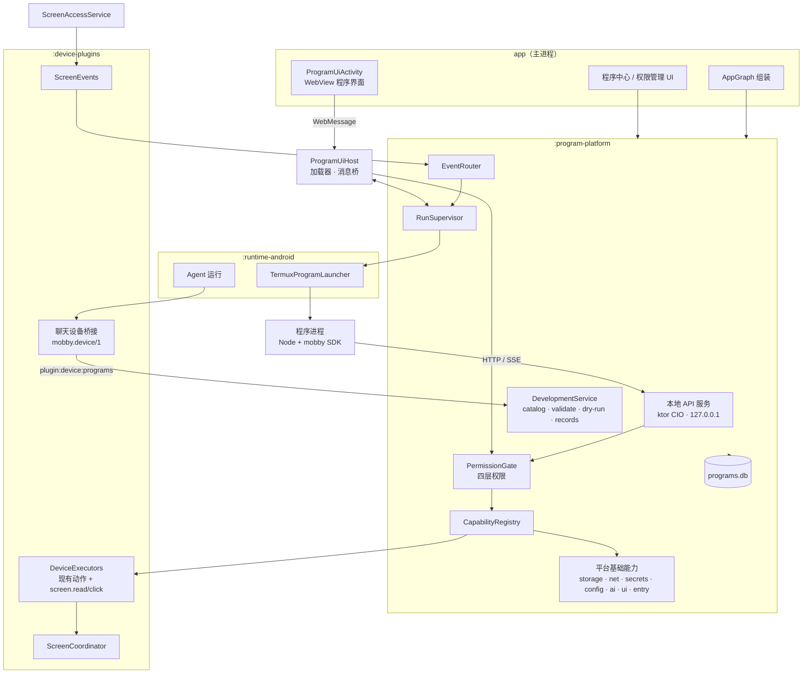
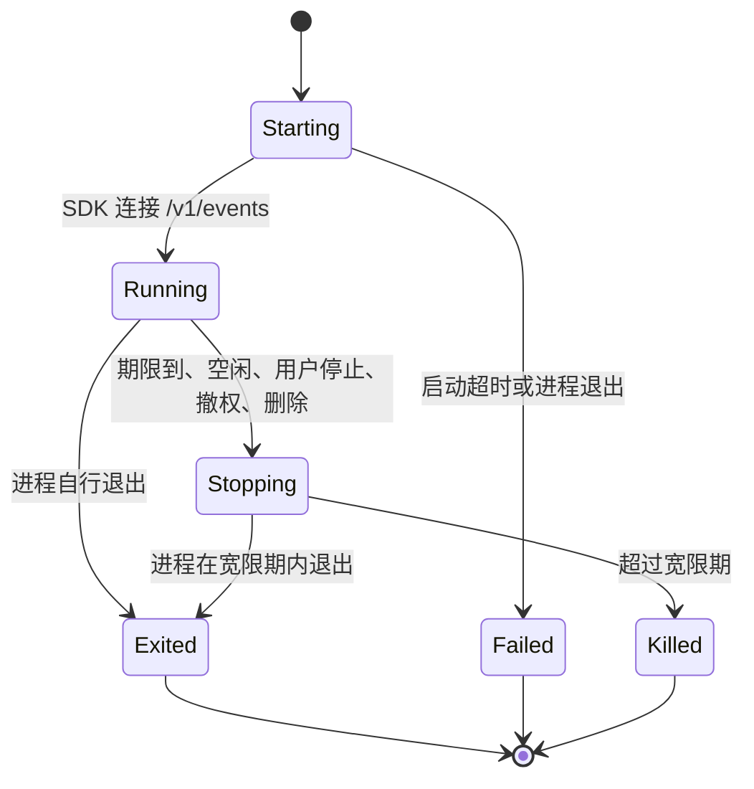
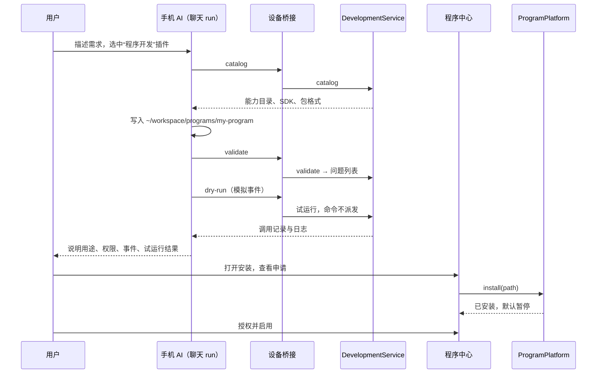
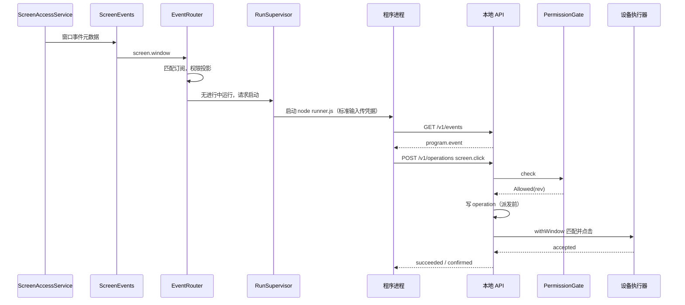

# 用户程序平台技术架构

状态：技术设计，尚未实现。日期：2026-10-24。

本文是 [Android 能力底座与用户程序平台设计](android-capability-platform.md) 的技术实现方案：模块划分、进程与线程、组件接口、协议、数据模型、关键时序、安全、测试和实施拆分。产品范围、权限规则和阶段目标以方案文档为准；两者冲突时先修订方案文档。

## 1. 设计约束

- 遵守 [AGENTS.md](../../AGENTS.md)：不获取 root，不修改系统权限；网关密钥只在加密存储；开发数据库结构变化直接重建；保持现有聊天执行路径和 `mobby.device/1` 协议不变。
- 手机能力只有一套执行实现：程序路径复用 `device-plugins` 中的执行器，不另写屏幕、短信等实现。
- 程序与 mobby 共享应用 UID。平台的权限只约束经过本地 API 的调用，不宣称程序间隔离。
- 本地 HTTP 服务沿用本地模型服务的做法：ktor CIO、只绑定 `127.0.0.1`、Bearer 令牌。
- 新模块必须进入 `runtime/test_module_boundaries.py` 的依赖白名单，依赖方向在测试中强制。

## 2. 总览



主路径：

1. 能力调用：程序进程 → 本地 API → 凭据认证 → 参数校验 → 权限闸门 → 操作记录 → 协调器 → 设备执行器 → 回执。
2. 事件：系统来源 → 事件路由 → 订阅匹配与权限投影 → 交给进行中的运行，或拉起新运行。
3. 开发：Agent 在聊天中通过现有设备桥接调用开发服务；安装和授权只在程序中心进行。

## 3. 模块划分

### 3.1 Gradle 模块与依赖

| 模块 | 目录 | 职责 | 允许的项目依赖 |
| --- | --- | --- | --- |
| `:program-platform`（新增） | `runtime/programs` | 能力注册、权限、程序存储、事件路由、运行管理、本地 API、开发服务 | `device-plugins`、`runtime-api`、`localization` |
| `:device-plugins`（扩展） | `runtime/device-plugins` | 设备执行器公开入口、屏幕读取与点击、屏幕事件、屏幕协调器、开发插件命令入口 | 不变：`runtime-api`、`localization` |
| `:runtime-android`（扩展） | `runtime/android` | 用 termux 执行器实现程序进程启动；安装 SDK 文件 | 增加 `program-platform` |
| `app`（扩展） | `app` | 组装平台；程序中心与权限管理 UI；承载程序界面的 `ProgramUiActivity` | 增加 `program-platform` |

依赖方向：`app → runtime-android → program-platform → device-plugins → runtime-api`。`device-plugins` 不依赖 `program-platform`；聊天开发插件需要的平台功能通过端口注入（见 3.3）。

源码包：`program-platform` 使用 `com.github.ytlog.mobby.android.programs`；`app` 中的界面使用 `com.github.ytlog.mobby.android.programcenter`。界面包可以复用 `conversation.ui` 的设置组件，`conversation.ui` 不引用程序平台，界面通过 `ConversationHostActions` 注入的页面插槽进入设置导航。

### 3.2 `:program-platform` 内部包

| 包 | 内容 |
| --- | --- |
| `capability` | `CapabilityDescriptor`、`CapabilityRegistry`、`CapabilityHandler`，以及把现有设备动作包装为能力的适配器 |
| `program` | `mobby.program/1` 清单模型、`ProgramPackageReader`、安装与版本管理 |
| `permission` | 四层权限模型、`PermissionResolver`、`PermissionGate`、到期计时 |
| `event` | 事件信封、`EventSource` 接口、屏幕与定时来源、`EventRouter`、订阅索引 |
| `run` | `RunSupervisor`、运行状态机、运行凭据、`ProgramProcessLauncher` 端口 |
| `api` | ktor 服务、路由、请求与错误协议、SSE |
| `dev` | 能力目录生成、校验、试运行、记录读取 |
| `base.storage` | 键值、私有文件、每个程序一个 SQLite 数据库，配额 |
| `base.net` | 受管 HTTP 与 WebSocket 客户端、域名检查、流量记录 |
| `base.secrets` | 程序凭据加密存储与请求时替换 |
| `base.config` | 清单配置字段、用户填写的值与校验 |
| `base.ai` | 经网关端口调用模型、次数与费用计量 |
| `base.ui` | `ProgramUiHost`：WebView 加载器、请求拦截、内容安全策略、消息桥、界面会话 |
| `base.entry` | 分享、快捷方式、通知动作入口的分发 |
| `store` | Room 数据库 `programs.db`、DAO、保留与清理 |
| 根包 | `ProgramPlatform` 门面，供 `app` 与 `runtime-android` 使用 |

### 3.3 `:device-plugins` 的扩展

| 新增 | 说明 |
| --- | --- |
| `DeviceExecutors`（公开） | 包装现有内部 `DeviceActions`，接受与传输无关的上下文：取消检查、临时目录、资源登记。聊天路径继续经 `DeviceCommands` 调用同一执行器 |
| `ScreenWindow`、`ScreenNode` | 当前窗口的不可变快照：包名、窗口类名、节点的 viewId、类名、文字、描述、可点击、可见、按显示比例的边界；密码字段显示为 `[secure]` |
| `ScreenAccessService.withWindow` | 在调用线程读取一次窗口，并在节点释放前按索引点击；不截图、不隐藏悬浮窗、不固定等待 |
| `ScreenEvents` | 无障碍事件的元数据转发与动态事件类型（`setServiceInfo`）；按需求方登记，取并集 |
| `ScreenCoordinator` | 聊天屏幕会话优先；后台派发租约；聊天动作等待进行中的后台派发 |
| `ProgramDevelopmentPort` | 开发插件命令的端口，由 `app` 在启动时注入平台实现；未注入时开发插件不可用 |
| 目录项 `programs` | `DeviceCatalog` 新增“程序开发”插件，命令 `catalog`、`validate`、`dry-run`、`records`，经现有桥接与令牌执行 |

现有 `snapshot`、`click(query)`、`tap` 等聊天动作的语义不变。

### 3.4 `:runtime-android` 的扩展

- `TermuxProgramLauncher` 实现 `ProgramProcessLauncher`：用现有 termux 执行器启动 `node`，独立进程组，记录 PID 与启动时间（沿用 `ProcessRegistry` 的身份校验做法）防止 PID 复用误杀。
- 运行时初始化时把 SDK（`mobby` 模块与 `runner.js`）写入前缀目录下的固定位置，随应用版本更新；程序进程通过 `NODE_PATH` 引用，不需要网络安装。
- 程序进程与 Agent 进程分开登记，取消和恢复互不影响。

## 4. 进程与线程

| 执行体 | 所在 | 说明 |
| --- | --- | --- |
| 平台控制 | 主进程，单线程协程调度器 | 程序安装、权限变更、订阅索引重建、运行状态变化都串行执行，避免竞态 |
| 事件路由 | 主进程，单线程 | 接收来源投递的事件，匹配订阅并分发；不读节点 |
| 无障碍回调 | 主线程 | 只提取元数据交给事件路由，立即返回 |
| 能力调用 | ktor 请求协程 + IO 调度器 | 屏幕读取与点击在后台线程；复用的旧屏幕动作仍按原实现切到主线程 |
| 本地 API | ktor CIO 线程 | 只绑定回环地址 |
| 程序进程 | 子进程（Node） | 由 `RunSupervisor` 拉起、监视和结束 |
| 程序界面 | 主线程 WebView；网页代码在系统 WebView 的隔离渲染进程 | 消息桥在主线程收到请求后立即转到 IO 调度器执行，结果再回主线程发给页面 |

- 不新增 Android 进程；`:local_model` 进程与本平台无关。
- 第一阶段的运行是有期限的短任务，不新增前台服务。无障碍服务被系统绑定期间主进程通常存活；定时触发由 WorkManager 唤起主进程。后台进程能否在各厂商系统上稳定拉起子进程，是第一阶段必须实测的问题（见第 13 节）。

## 5. 核心组件

### 5.1 能力注册表

```kotlin
data class CapabilityDescriptor(
    val id: String,                 // "screen.read"
    val version: Int,
    val kind: CapabilityKind,       // QUERY, COMMAND, EVENT, SESSION, HANDOFF
    val inputSchema: JsonObject,
    val outputSchema: JsonObject,
    val scope: ScopeKind,           // NONE, PACKAGES, RECORDS, DIRECTORIES
    val sideEffects: Set<SideEffect>,
    val prerequisites: List<Prerequisite>,
    val timeoutMillis: Long,
    val cancellable: Boolean,
    val limits: CapabilityLimits,
)

interface CapabilityHandler {
    val descriptor: CapabilityDescriptor
    fun availability(system: SystemState): Availability
    suspend fun invoke(call: CapabilityCall): CapabilityOutcome
}
```

- 注册表在启动时由代码登记，只包含有处理器的能力；目录、SDK 类型和开发技能都从注册表生成。
- 适配器把 `screen.tap` 等调用转换为 `DeviceExecutors.perform("screen", "tap", args, context)`，结果 `DeviceResult` 的 `effectState` 原样映射为调用结果的效果状态。
- `screen.read` 和 `screen.click` 直接使用 `ScreenAccessService.withWindow`；`screen.click` 的参数是节点描述（viewId、文字、描述、类名、区域），在同一次读取中匹配，恰好一个时点击，否则返回 `TARGET_NOT_UNIQUE` 或 `RESOURCE_MISSING`。

### 5.2 权限闸门

```kotlin
class PermissionGate(store: GrantStore, switches: SwitchStore, system: SystemState, clock: Clock) {
    fun check(run: RunIdentity, capability: CapabilityDescriptor, scope: CallScope): GateDecision
}

sealed interface GateDecision {
    data class Allowed(val grantRevision: Long) : GateDecision
    data class Denied(val layer: Layer, val reason: DenyReason) : GateDecision
}
```

- 按“系统权限 → 全局开关 → 程序权限（开启、范围、到期）→ 本次运行上下文”的顺序检查，返回第一个不满足的层和原因。
- 允许时返回授权修订号；派发前再次比较当前修订号，变化则重新检查，避免排队期间撤权后继续派发。
- 撤权、关闭全局开关、到期时，平台控制线程先更新授权，再取消该程序未派发的调用并通知运行。

### 5.3 程序存储与安装

- `ProgramPackageReader` 校验目录：只接受普通文件和子目录，拒绝符号链接、绝对路径和 `..`；限制文件数和总大小；清单严格解码，未知字段拒绝；入口文件必须存在；权限申请只能引用注册表中的能力，范围必须符合该能力的 `ScopeKind`；订阅只能引用事件能力，且过滤范围不超出对应权限申请。
- 安装把文件复制到 `files/programs/packages/<id>/<version>-<checksum>/`，先写临时目录再原子重命名；数据库记录版本和校验和。运行时从安装副本执行，不从工作区执行，避免安装后被改动的文件直接生效。
- 更新时旧版本的运行按旧版本结束；新版本的权限只继承旧授权与新申请的交集，扩大部分需要用户授予。

### 5.4 事件路由

```kotlin
interface EventSource {
    val type: String                       // "screen.window"
    fun demand(scopes: Set<Scope>)        // 由路由按有效订阅的并集设置
}

data class ProgramEvent(
    val eventId: String, val type: String, val source: String,
    val observedAt: Long, val expiresAt: Long?, val scope: Scope, val payload: JsonObject,
)
```

- 订阅索引按事件类型和范围建立，权限、订阅、启用状态变化时在平台控制线程重建，再整体替换给路由线程。
- 每个事件先过滤，再做权限投影：只有当前授权范围内的订阅能收到。
- 分发：该订阅已有进行中的运行时，放入运行的事件队列（有界，屏幕类事件可合并只保留最新）；否则请求 `RunSupervisor` 拉起新运行。
- 屏幕来源：`ScreenEvents` 在有订阅时增加内容变化事件类型；事件只含包名、类名、时间，程序需要节点时调用 `screen.read`。
- 定时来源：`time.schedule` 订阅登记为 WorkManager 任务（周期最短 15 分钟）；需要精确时间且满足条件时使用 AlarmManager。到期后唤起主进程，由路由按订阅拉起运行。错过策略按订阅配置。
- 平台事件：`permission.changed`、`subscription.changed`、`run.stopping` 由平台直接投递给相关运行。

### 5.5 运行管理

```kotlin
interface ProgramProcessLauncher {
    fun launch(spec: ProcessSpec): ProgramProcess
}

data class ProcessSpec(
    val runId: String, val programDir: File, val entry: String,
    val workingDir: File, val sdkDir: File, val apiPort: Int, val credential: String,
)

interface ProgramProcess {
    val pid: Int
    suspend fun awaitExit(): Int
    fun terminate()        // SIGTERM 进程组，宽限期后 SIGKILL
}
```

运行状态：



- 每次运行生成随机凭据，绑定 programId、版本、runId、是否试运行；凭据只保存在内存，运行结束即作废。凭据通过子进程的标准输入第一行传入，不放在参数、环境变量或文件里。
- 每个程序的每次运行是一个独立的 Node 进程；多个程序可以同时运行，各自一个进程。同一程序同一时间最多一个运行，后续事件送入这个运行。
- 不采用“一个共享 Node 进程里用 `worker_threads` 或 `vm` 跑多个程序”：那样一个程序的崩溃、死循环或内存耗尽会拖垮其他程序，结束单个程序也只能结束整个进程，运行身份更难分开。独立进程用进程组结束，互不影响。
- 全局同时运行的程序数、单个运行期限、空闲退出时间有上限，数值实测后进入配置；达到上限时新触发排队，排队有长度上限和过期时间，超出的触发记为丢弃并写明原因。
- 每个 Node 进程常驻内存约数十 MB，具体以真机测量为准；空闲退出可以避免多个程序长期占用内存。
- Android 12 起系统会限制应用派生的子进程（phantom process），子进程总数过多或在后台持续占用 CPU 时可能被系统结束。全局并发上限必须低于这个限制，进程被系统结束时运行记为“被系统结束”，不显示为成功或普通失败。
- 运行结束时取消其未完成的调用：未派发的标记为取消；已派发的等待执行器回执，拿不到可靠结果的记为 `EFFECT_UNKNOWN`。
- 应用进程重启时：按 PID 与启动时间结束遗留的程序进程；未结束的运行记为中断；已派发未回执的调用记为结果不明，不重发。

### 5.6 本地 API 服务

- ktor CIO，`127.0.0.1`，端口由系统分配，平台启动时创建、关闭时停止。
- 所有请求需要 `Authorization: Bearer <run credential>`；拒绝带 `Origin` 头的请求，`Host` 必须是回环地址，不开启 CORS。
- 请求体大小、并发请求数和每个运行的调用速率有上限。
- 管理类操作（安装、启用、授权）不在这个 API 上提供，只能在程序中心完成。
- 程序界面不使用这个 HTTP 服务，而是使用 WebView 消息桥；两者进入同一条调用管线。

### 5.7 开发服务

`DevelopmentService` 实现 `ProgramDevelopmentPort`，供聊天开发插件调用：

| 命令 | 实现 |
| --- | --- |
| `catalog` | 从注册表生成能力列表（ID、Schema、副作用、范围、本机可用性）、SDK 说明和程序包格式；同时写入本轮技能目录 |
| `validate` | 对工作区路径运行 `ProgramPackageReader`，不安装；返回问题列表 |
| `dry-run` | 以试运行凭据拉起运行：只接收请求中提供的模拟事件；查询类能力只在本轮聊天已选中的设备插件范围内执行；命令类能力不派发，记录调用并返回 `SIMULATED`；运行期限更短，结束后删除临时数据 |
| `records` | 只读取本轮草稿中以 `plugin:program:<id>` 附加的程序的运行与调用记录 |

- 工作区路径必须位于默认工作区的 `programs/` 下，使用现有 `DevicePaths` 的包含检查。
- 开发插件不提供安装、启用、授权和恢复订阅的命令。

### 5.8 平台基础能力

平台基础能力实现为普通的 `CapabilityHandler`，与手机能力共用注册、权限闸门、操作记录和配额。

#### 存储

| 能力 | 实现 |
| --- | --- |
| `storage.kv` | `programs.db` 的 `program_kv` 表；键长、值大小和总量有上限 |
| `storage.files` | `files/programs/data/<programId>/files/` 下的相对路径；规范化后必须仍在该目录内，拒绝符号链接；大文件以流式读写 |
| `storage.sql` | 每个程序一个 SQLite 文件 `files/programs/data/<programId>/sql/main.db`，用 Android `SQLiteDatabase` 打开 |

`storage.sql` 的接口与限制：

- `execute(sql, params)`、`query(sql, params)` 和 `transaction(statements)`；参数只能按位置绑定，结果行数和单次结果大小有上限。
- 每次调用只接受一条语句。词法检查在字符串和注释之外拒绝 `ATTACH`、`DETACH`、`VACUUM INTO`、`load_extension` 以及白名单外的 `PRAGMA`，避免受管路径打开程序目录以外的数据库文件。
- 打开时设置 `max_page_count` 实现配额，并关闭 `trusted_schema`。
- 每个程序一个连接，按程序串行执行；运行结束时回滚未提交的事务。
- 程序删除时由用户选择是否删除数据目录。

#### 网络

- 使用 Android 平台的 `HttpURLConnection`，经 Android 网络栈发出，不新增网络库。关闭自动重定向，每一跳重新检查域名与方法。
- 授权范围是域名列表（精确主机名或 `*.` 后缀）与方法；默认只允许 HTTPS，HTTP 需要单独授权。
- 解析出的地址属于回环、链路本地、局域网私有段或组播时拒绝，防止程序经受管网络访问本机的程序 API、本地模型服务或局域网设备。DNS 解析与实际连接之间仍可能变化，这一限制如实记录。
- 请求体、响应体、超时、并发连接数有上限。超过内联上限的响应写入程序目录的临时文件，以文件引用返回。
- 每次请求在操作记录中保存域名、方法、状态码、上下行字节数和耗时，不保存请求体和响应体。
- `net.websocket` 作为会话实现：连接属于一次运行，消息经事件流送达程序，运行结束时关闭。

#### 凭据

- 使用独立 Keystore 别名 `mobby.programs` 的 AES-GCM 密钥加密，密文存入 `program_secret`；不复用网关的 `mobby.gateway` 别名。
- 程序可以写入凭据、列出名称、删除凭据，不能读回明文。用户也可以在程序中心填写。
- 每个凭据绑定允许发往的域名，绑定范围必须在该程序的 `net.http` 授权之内。
- 程序在 `net.http` 请求的请求头或查询参数中写 `{{secret:<name>}}`，平台在发出前替换；目标主机不在绑定域名内时返回 `SCOPE_DENIED`。替换后的值不进入操作记录、日志和错误信息。
- 平台无法阻止远端服务在响应中回显凭据；这一点在开发说明中写明。

#### 配置

- 清单 `config` 声明字段：键、类型（字符串、数字、布尔、枚举、应用包名、凭据）、是否必填、默认值、显示名称。
- 值保存在 `program_config`；凭据类型的字段保存在 `program_secret`，配置中只保存名称。
- 必填字段缺失时程序可用性为“需要配置”，不接收事件。配置变化向运行投递 `config.changed`。

#### 模型调用（第二阶段）

- `runtime-android` 实现 `ModelGatewayPort`，使用用户已配置的网关和现有本地 Node 桥接，按现有网关协议规则发出请求；网关地址和密钥不对程序开放。
- 授权范围是允许的模型；每个程序有每日次数和费用上限，超出返回 `CONDITION_UNMET`。
- 调用记录保存模型、输入输出 token 数和耗时，不保存提示词正文。接入前需对照 [网关接入](../gateway.md) 确认协议与计费字段。

#### 界面（WebView）

程序界面是程序包 `ui/` 下的网页，由 `app` 中的 `ProgramUiActivity` 用 WebView 显示，加载、拦截和消息桥由 `program-platform` 的 `ProgramUiHost` 实现。依赖 `androidx.webkit`（新增依赖，版本按项目规则选择已发布两周以上的稳定版）。

加载：

- 每个程序使用独立的页面源 `https://<programId>.program.invalid/`。`.invalid` 是保留顶级域，不会解析到真实网站。
- `WebViewAssetLoader` 把该源的路径映射到程序安装副本的 `ui/` 目录；`/_mobby/sdk.js` 由平台提供。只从安装副本读取，工作区的改动要重新安装才生效。
- WebView 设置：关闭 `allowFileAccess`、`allowContentAccess`、地理位置、多窗口；关闭 DOM Storage 与 Web SQL，程序数据统一走 `storage.*`；禁止混合内容；保持安全浏览开启。

请求拦截与内容安全策略：

- `shouldInterceptRequest`：本程序源内的请求由加载器返回，其他所有请求返回 403。
- 平台返回的 HTML 附带内容安全策略：`default-src 'self'; script-src 'self'; style-src 'self' 'unsafe-inline'; img-src 'self' data: blob:; connect-src 'self'; frame-src 'none'; object-src 'none'; base-uri 'none'; form-action 'none'`。WebSocket 和外部 `fetch` 因此被浏览器拒绝，页面联网只能经消息桥调用 `net.http`。
- Service Worker 请求同样经拦截器处理，只允许本程序源。
- `shouldOverrideUrlLoading`：本程序源内导航允许；其他链接不在 WebView 内打开，经用户确认后交给系统浏览器。
- `WebChromeClient`：`onPermissionRequest` 一律拒绝；`onCreateWindow` 拒绝；文件选择经平台的交接能力完成，需要用户在页面中主动操作。
- `onRenderProcessGone`：销毁该 WebView，显示错误并允许重新打开，不影响 mobby 主进程。

消息桥：

- 用 `WebViewCompat.addWebMessageListener` 注册名为 `mobbyBridge` 的监听，允许的源只有本程序源；不使用 `addJavascriptInterface`。
- 每次打开界面生成界面会话 `uiSessionId`，绑定 programId 与版本。页面消息为 `{"id":"m-1","capability":"storage.sql","args":{...}}`，经同一条能力调用管线（参数校验、权限闸门、操作记录）执行，调用上下文标注为界面会话。
- 结果和推送经 `replyProxy.postMessage` 返回页面。消息大小与每秒调用次数有上限。
- 运行时检查 `WebViewFeature.WEB_MESSAGE_LISTENER`；不支持时不打开程序界面并提示更新系统 WebView。

界面与后台：

- 页面调用 `mobby.ui.send(message)`：平台向该程序的后台投递 `ui.message` 事件，没有进行中的运行时按需拉起；只有界面的程序收到“无后台逻辑”的错误。
- 后台调用 `mobby.ui.post(message)`：平台转发给该程序已打开的界面会话；没有打开的界面时返回 `CONDITION_UNMET`，不排队。
- 关闭页面即结束界面会话；界面会话不延长后台运行的期限。

渲染与外观：

- `ProgramUiActivity` 全屏显示，顶部保留 mobby 的标题栏（程序名称、返回、停止），程序不能隐藏它，用户始终能识别当前是哪个程序并退出。
- 平台把浅色或深色模式、系统字体缩放和安全区域边距以 CSS 媒体查询和变量提供给页面；页面自行适配。

#### 入口（第二阶段）

- `entry`：APK 静态声明一个分享接收 Activity、动态快捷方式的分发 Activity 和通知动作接收器，按 programId 分发为 `entry.share`、`entry.shortcut`、`entry.notification` 事件。分享内容以资源引用交给程序；外部 Intent 的自报身份不被信任。

#### 日志

- `log` 写入运行记录，单条长度和每分钟条数有上限；超出部分截断并标注。

### 5.9 程序中心

- `ProgramCenterViewModel` 订阅平台暴露的 `Flow`：程序列表、权限、订阅、全局开关、系统权限状态、运行与调用记录。
- 页面：程序列表、安装确认、程序详情（概览、权限、事件、运行记录）、权限管理（按能力、按程序、按事件来源）。
- 安装确认页展示来源目录、文件清单、权限申请与范围、订阅；确认后调用平台安装。
- 所有修改经平台门面执行，界面不直接访问数据库。

## 6. 协议

### 6.1 能力调用

```http
POST /v1/operations
Authorization: Bearer <run credential>
Content-Type: application/json

{"schema":"mobby.program-api/1","requestId":"r-42","capability":"screen.click",
 "args":{"viewId":"com.example.app:id/skip"},"deadlineMs":3000}
```

成功：

```json
{"requestId":"r-42","operationId":"op-9","status":"succeeded","effect":"confirmed",
 "result":{"accepted":true}}
```

失败：

```json
{"requestId":"r-42","operationId":"op-9","status":"failed","effect":"none",
 "error":{"code":"PERMISSION_DENIED","layer":"program","reason":"program_off"}}
```

- `requestId` 在一次运行内唯一；相同 `requestId` 且参数指纹相同返回原操作，参数不同返回 `REQUEST_CONFLICT`。
- `GET /v1/operations/{requestId}` 查询原操作，用于超时或断线后确认结果。
- `status` 取值：`succeeded`、`failed`、`cancelled`、`timeout`、`unknown`、`simulated`；`effect` 取值：`none`、`confirmed`、`unknown`。

### 6.2 事件流

```http
GET /v1/events
Authorization: Bearer <run credential>
Accept: text/event-stream
```

```text
event: program.event
data: {"eventId":"e-7","type":"screen.window","subscription":"app-window","observedAt":1761282000000,
       "scope":{"package":"com.example.app"},"payload":{"packageName":"com.example.app","className":"com.example.app.SplashActivity"}}

event: run.stopping
data: {"reason":"permission_changed"}
```

SDK 连接事件流即表示运行进入 `Running`；收到 `run.stopping` 后 SDK 停止接收新事件并在宽限期内退出。

### 6.3 其他入口

| 入口 | 说明 |
| --- | --- |
| `GET /v1/capabilities` | 本程序可见的能力、Schema 与可用性 |
| `GET /v1/permissions` | 本程序的权限状态与原因 |
| `POST /v1/permissions/requests` | 提交权限申请，等待用户在程序中心处理 |
| `GET/POST/DELETE /v1/subscriptions` | 本程序订阅的查询、登记与注销，范围不超出授权 |
| `GET/PUT/DELETE /v1/storage/kv/{key}` | 键值存储 |
| `GET/PUT/DELETE /v1/storage/files/{path}`、`GET /v1/storage/files?dir=` | 私有文件读写与列表，流式传输 |
| `POST /v1/storage/sql` | `{"op":"query"|"execute"|"transaction", ...}` |
| `POST /v1/net/http` | 受管 HTTP 请求，响应内联或以文件引用返回 |
| `GET/PUT/DELETE /v1/secrets/{name}` | `GET` 只返回名称、绑定域名和更新时间，不返回明文 |
| `GET /v1/config` | 本程序配置，凭据字段只给名称 |
| `POST /v1/log` | 写入运行记录，有长度与频率限制 |

### 6.4 SDK

```javascript
const mobby = require("mobby");

mobby.on("app-window", async (event, ctx) => { /* 处理事件 */ });
await mobby.capabilities.list();
await mobby.call("sms.list", {});
await mobby.screen.read();
await mobby.screen.click({ viewId, text });
await mobby.permissions.list();
await mobby.permissions.request("screen.click", { packages: ["com.example.app"] });
await mobby.kv.set("key", value);
await mobby.files.write("reports/today.json", JSON.stringify(data));
await mobby.sql.execute("CREATE TABLE IF NOT EXISTS item(id TEXT PRIMARY KEY, price REAL)");
const rows = await mobby.sql.query("SELECT * FROM item WHERE price < ?", [100]);
const config = await mobby.config.get();
await mobby.secrets.put("api-token", token, { domains: ["api.example.com"] });
const response = await mobby.net.fetch("https://api.example.com/items", {
  headers: { Authorization: "Bearer {{secret:api-token}}" },
});
await mobby.log("fetched", { status: response.status });
```

- `runner.js` 读取标准输入中的凭据，加载程序入口，连接事件流，把事件分发给 `mobby.on` 注册的处理函数；处理函数异常写入运行记录，不吞掉。
- 每个调用自动生成 `requestId`；超时后先查询原操作，不用新 ID 重发。
- 错误抛出带 `code`、`layer`、`reason` 的 `MobbyError`。

### 6.5 界面消息桥

页面到平台：

```json
{"id":"m-1","capability":"storage.sql","args":{"op":"query","sql":"SELECT * FROM item","params":[]}}
```

平台到页面：

```json
{"id":"m-1","status":"succeeded","effect":"none","result":{"rows":[]}}
{"type":"ui.message","payload":{"type":"updated"}}
```

`status`、`effect` 和错误格式与 HTTP 调用一致。

### 6.6 开发插件命令

经现有 `mobby.device/1` 桥接调用，参数与结果为 JSON：

```text
catalog
validate {"path":"~/workspace/programs/my-program"}
dry-run  {"path":"~/workspace/programs/my-program","events":[{"type":"screen.window","payload":{...}}],"timeoutMs":20000}
records  {"programId":"my-program","limit":50}
```

## 7. 数据模型

`programs.db`（Room，开发阶段结构变化直接重建）：

| 表 | 主要字段 |
| --- | --- |
| `program` | programId、名称、用户状态、当前版本、安装时间、更新时间 |
| `program_version` | programId、版本、校验和、安装路径、入口、清单 JSON、安装时间 |
| `program_grant` | programId、能力、授予范围、申请范围、开启、必需、来源、授予时间、到期时间、修订号 |
| `permission_request` | 请求 ID、programId、能力、范围、状态、时间 |
| `subscription` | 订阅 ID、programId、版本、事件类型、过滤范围、handler、来源（清单或运行时）、用户暂停、最近触发时间、触发次数 |
| `capability_switch` | 能力、全局开关、修改时间 |
| `run` | runId、programId、版本、触发来源与订阅、是否试运行、开始结束时间、终态、退出码、原因 |
| `operation` | operationId、runId、requestId、参数指纹、能力、授权修订号、受理派发完成时间、状态、效果、错误；网络调用另存域名、方法、状态码、字节数 |
| `program_kv` | programId、键、值、更新时间 |
| `program_config` | programId、键、值 JSON、更新时间 |
| `program_secret` | programId、名称、密文、IV、绑定域名、创建时间、更新时间 |
| `model_usage` | programId、日期、次数、输入输出 token、估算费用（第二阶段） |

- `operation` 在派发前写入，回执后更新，用于去重和重启后的结果核对。
- 记录默认不保存整页节点、短信正文和截图；调用参数中的正文类字段只保存长度与摘要。`run` 和 `operation` 按条数和天数清理。
- 程序私有数据保存在 `files/programs/data/<programId>/`：`files/` 为私有文件，`sql/main.db` 为程序数据库，`tmp/` 为大响应等临时文件，与安装包目录分开。

## 8. 关键时序

### 8.1 手机 AI 编写并由用户安装



### 8.2 事件触发与能力调用



### 8.3 运行中撤权

1. 用户在程序中心关闭 `screen.click`；平台控制线程更新授权并增加修订号。
2. 闸门对该程序之后的调用返回 `PERMISSION_DENIED`；已通过闸门但未派发的调用在派发前因修订号变化被拒绝。
3. 若关闭的是必需权限，平台向运行发送 `run.stopping`，宽限期后结束进程；订阅索引重建，不再拉起该程序。
4. 运行记录写入原因 `permission_changed`。

### 8.4 应用进程重启

1. 平台启动时读取遗留的程序进程身份，校验启动时间后结束它们。
2. 未结束的 `run` 记为中断；已派发未回执的 `operation` 记为 `unknown`。
3. 重建订阅索引和事件来源需求，重新登记定时任务；不重放进程停止期间的屏幕事件。

## 9. 安全

| 风险 | 处理 |
| --- | --- |
| 局域网或网页访问本地 API | 只绑定回环；拒绝 `Origin` 头和非回环 `Host`；不开启 CORS |
| 一个程序冒充另一个程序 | 身份只来自运行凭据；凭据随运行生成、只在内存、运行结束作废 |
| 程序自行扩大权限 | API 不提供授权入口；申请只进入待处理列表；更新不自动扩大 |
| 绕过 SDK 的同 UID 代码 | 无法阻止；程序中心如实说明；只支持用户信任的程序 |
| 读取网关密钥和用户配置 | 不提供相关能力；凭据与配置不进入程序目录、环境变量和日志 |
| 恶意或损坏的程序包 | 严格校验路径、大小、文件类型和清单；从安装副本运行 |
| 资源耗尽 | 运行期限、并发、事件队列、请求速率、数据配额都有上限 |
| 经受管网络访问本机或局域网 | 拒绝回环、链路本地、私有和组播地址；重定向逐跳检查 |
| 凭据泄露 | 加密存储、不可读回、只在请求发出时替换、只发往绑定域名、不进入记录 |
| 受管数据库访问其他文件 | 单语句、拒绝 `ATTACH` 等语句、配额页数限制 |
| 程序直接使用 Node 网络、文件、数据库 | 无法阻止；程序中心说明；校验时提示 |
| 程序界面访问网络、文件或其他程序 | 独立页面源；拦截所有非本程序请求；内容安全策略禁止外部连接；关闭文件与内容访问 |
| 页面冒充其他程序调用能力 | 消息监听只接受本程序源；调用身份来自界面会话 |
| 页面伪装成 mobby 或系统界面 | 固定标题栏显示程序名称与退出入口，程序不能隐藏 |
| 外部内容诱导 | 屏幕文字、通知内容等作为数据返回，不影响授权判断 |

## 10. 可靠性与结果语义

- 调用状态与效果分开：`succeeded/confirmed` 才表示副作用已确认；`unknown` 不能显示为成功。
- 派发前持久化调用记录；超时或断线后按 `requestId` 查询原操作。
- 平台不对没有幂等保障的操作自动重试。
- 运行结束和进程退出码不等于业务成功；运行记录保留每次调用的独立状态。

## 11. 性能

- 无障碍回调只做元数据转发；节点读取只发生在程序调用 `screen.read` 或 `screen.click` 时。
- 同一订阅的连续事件在一次运行内处理，避免每个事件都启动 Node。
- 屏幕事件在队列中合并，只保留最新状态。
- Node 启动耗时、读取窗口耗时、事件到点击的端到端延迟在第一阶段真机上测量后再确定期限和合并参数。

## 12. 测试策略

| 层 | 内容 | 工具 |
| --- | --- | --- |
| 程序包与清单 | 合法包、未知字段、路径穿越、符号链接、超限、越权订阅 | JUnit |
| 权限闸门 | 四层组合、到期、修订号竞态、撤权后排队调用 | JUnit |
| 事件路由 | 过滤、权限投影、合并、暂停订阅、需求并集 | JUnit |
| 运行管理 | 启动超时、空闲退出、强制结束、重启恢复，使用假启动器 | JUnit + 协程测试 |
| 本地 API | 认证、Origin/Host 拒绝、去重、冲突、错误格式、SSE | ktor `testApplication` |
| 存储 | DAO、清理、重建 | Robolectric + 内存 Room |
| 平台基础能力 | 文件路径越界、SQL 禁止语句与配额、域名与私有地址拒绝、重定向检查、凭据替换与不落日志、配置必填 | JUnit + Robolectric；网络用本机测试服务器 |
| 设备扩展 | 窗口快照、事件转发、协调器、聊天路径回归 | Robolectric |
| 界面宿主 | 加载器路径映射与越界拒绝、外部请求拒绝、CSP 头、消息桥源校验与调用管线、界面与后台消息 | JUnit/Robolectric 覆盖纯逻辑；WebView 行为在已连接手机上用仪器测试验证 |
| SDK | runner 的凭据读取、事件分发、错误、超时查询 | `node --test` |
| 模块边界 | 新模块依赖白名单与包引用 | `runtime/test_module_boundaries.py` |
| 真机 | 见方案文档各阶段验收 | 已连接手机 |

对可复现的缺陷先写失败的回归测试再修复。完成后运行 [AGENTS.md](../../AGENTS.md) 列出的 Node、Python 和 Gradle 检查，并补充 `:program-platform:testDebugUnitTest` 与 SDK 测试。

## 13. 实施拆分

第一阶段（底座）按以下顺序实施，每项完成后独立测试与提交：

| 序号 | 工作项 | 依赖 |
| --- | --- | --- |
| 1 | 新建 `:program-platform` 模块与边界测试更新；`programs.db` 与 DAO | — |
| 2 | 能力注册表与描述；`DeviceExecutors` 公开入口；现有查询与命令能力的适配器 | 1 |
| 3 | 程序包读取、安装、版本、删除；清单配置字段 | 1 |
| 4 | 权限模型、闸门、全局开关、到期 | 1、2 |
| 5 | 本地 API 服务、认证、操作去重与记录 | 2、4 |
| 6 | 运行管理与 `TermuxProgramLauncher`；SDK 与 runner | 5 |
| 7 | 存储：`storage.kv`、`storage.files`、`storage.sql` 与配额 | 5 |
| 8 | 网络与凭据：`net.http`、`secrets`、`config`、`log` | 5、7 |
| 9 | 订阅持久化与事件路由；`time.schedule`；`notify.show` | 4、6 |
| 10 | 开发服务与聊天开发插件 | 3、6 |
| 11 | 程序中心、安装确认、配置表单与权限管理页 | 3、4、8、9 |
| 12 | 程序界面：`ProgramUiHost`、`ProgramUiActivity`、页面 SDK、界面与后台消息 | 5、6、11 |
| 13 | 真机验收：手机 AI 编写一个带界面的程序，后台定时拉取接口数据写入数据库并按条件通知，界面展示数据并可手动刷新；完成配置、安装、授权、运行、撤权、删除 | 全部 |

第二阶段在此之上增加 `screen.window`、`screen.read`、`screen.click`、`ScreenEvents`、`ScreenCoordinator`，以及 `entry`、`net.websocket` 与 `ai.call`。

## 14. 待验证问题

- 应用在后台时，由无障碍事件或 WorkManager 触发能否在主流厂商系统上稳定拉起 Node 子进程；若不能，是否需要为程序运行增加前台服务及其类型与用户可见状态。
- Node 冷启动耗时是否满足屏幕事件场景；若不满足，是否允许运行在空闲期限内保持进程。
- 定时任务在省电策略下的实际延迟。
- 高频内容变化事件对耗电和主线程的影响。
- 受管网络在系统代理、VPN 和省电模式下的行为，以及大文件下载对存储配额的影响。
- Android 12 及以上的子进程限制在两台已连接手机上的实际阈值，以及程序进程、Agent 进程、终端进程同时存在时的表现。
- 两台已连接手机的系统 WebView 版本是否支持 `WEB_MESSAGE_LISTENER`，以及内容安全策略、Service Worker 拦截在这些版本上的实际行为。
